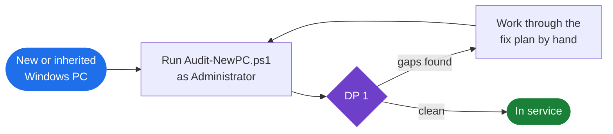

# win-security-posture-audit

A read-only PowerShell audit of a Windows 10/11 machine's security and health posture. Run it on a new or inherited PC to see what you are dealing with before you trust it.

## When to run it



## What it checks

- TPM, Secure Boot, virtualization-based security, Windows activation
- Defender and BitLocker posture, firewall profiles, network configuration
- Installed programs (registry, Appx, provisioned), optional features, startup items, services, scheduled tasks
- Drivers and problem devices, pending reboot, installed hotfixes
- Hardware health: NVMe SMART and wear, battery, GPU and display, memory
- Privacy, telemetry and bloatware posture, top memory consumers, folder sizes

## Safety

Read-only. The script never runs Set-, Remove-, Stop- or Disable- commands against the system. It only writes a report folder to your Desktop, including a `DEGARBAGE-PLAN.md` of suggested fixes that it does not apply. It does not open cloud file contents (no OneDrive or Dropbox hydration).

CI enforces this on every push: a lint job fails on any PSScriptAnalyzer error, and a Pester test parses the script and fails on any state-changing command outside a short, commented allowlist. A second test proves the guard catches `Set-ItemProperty` and `Remove-Item` in a sample script.

## Usage

Open Terminal as Administrator for the fullest results, then:

```powershell
Set-ExecutionPolicy -Scope Process Bypass -Force
.\Audit-NewPC.ps1
```

Output lands in `Desktop\NewPC-Audit-<timestamp>\`: `report.md`, `DEGARBAGE-PLAN.md`, CSV inventories and a run log.

## License

MIT. See LICENSE.

## Security

See SECURITY.md for how to report a vulnerability.
